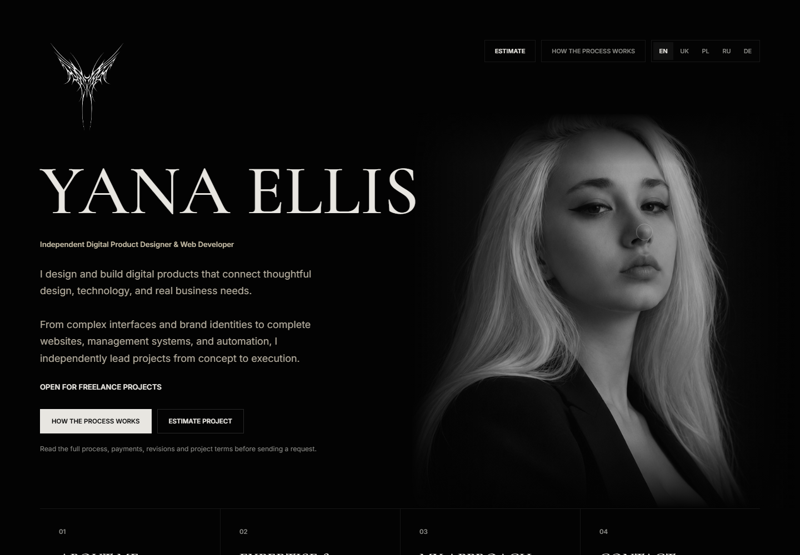
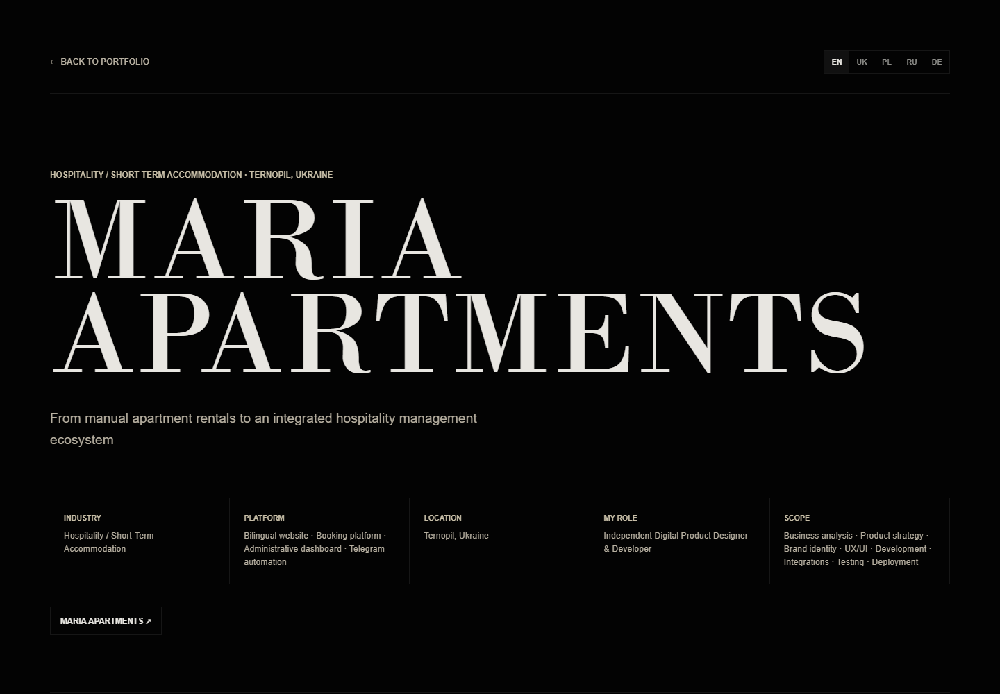
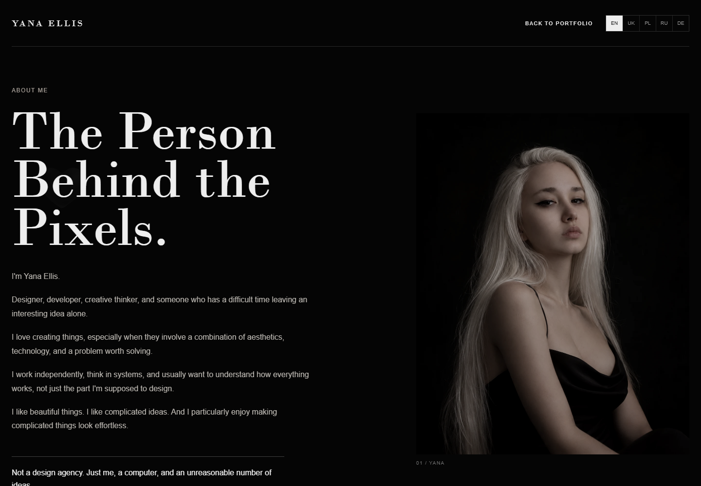

# Yana Ellis — Professional Portfolio

Independent digital product design and development portfolio featuring commercial websites, UX case studies, and conceptual digital experiences.

## Live Website

https://yanaellis.com

## Overview

Yana Ellis is an independent digital product designer and web developer. This repository contains the portfolio site: a multilingual presentation of commercial work, UX case studies, conceptual projects, an About Me page, a Professional Profile, and project enquiry tools.

## Features

- Multilingual portfolio presentation
- Commercial UX case studies with project-specific routes
- Conceptual project carousel
- Personal About Me page
- Detailed Professional Profile
- Interactive project estimate pages for Canada, Poland, and Ukraine
- Project guide, FAQ, privacy policy, and terms pages
- Contact and enquiry experiences
- Interactive portrait and project navigation elements
- Desktop-layout presentation across supported device widths

## Technology Stack

The core portfolio is a static HTML, CSS, and vanilla JavaScript site. Server-side functionality is provided by Vercel Functions under `api/`. The repository also includes the supporting packages used by the enquiry workflow, including `@vercel/blob` and `pdfkit`.

The `projects/` directory contains selected project implementations and case-study material. Those individual projects may use React/Vite or Next.js where their own source requires it; the portfolio shell itself does not depend on React or Next.js.

## Project Structure

```text
index.html                  Portfolio homepage
about.html                  Personal About Me page
professional-profile.html   Detailed professional profile
commercial-case.html        Shared commercial case-study route
commercial-*.js             Commercial project data and localization
projects/                   Selected conceptual project pages and assets
calculator/                 Regional estimate experiences
offers/                     Standalone offer pages
api/                        Vercel serverless handlers
assets/                     Portfolio imagery and project covers
docs/screenshots/            Current production screenshots used below
```

## Local Development

There is no framework build script in the root `package.json`; the portfolio pages can be served as static files:

```bash
pnpm install
npx serve .
```

To exercise the Vercel Functions locally, use the Vercel CLI in a configured environment:

```bash
npx vercel dev
```

Environment variables are documented by `.env.example`. Do not commit production credentials.

## Deployment

The portfolio is deployed through Vercel. Production configuration and secrets remain outside the repository. Changes to the connected production branch are built by the Vercel Git integration; no private environment values are stored in this codebase.

## Screenshots

These screenshots were captured from the current public production site.

### Homepage



### Commercial Case Study



### About Me



## Project Status

Active / Maintained

## Contact

- Portfolio: https://yanaellis.com
- LinkedIn: https://www.linkedin.com/in/yana-ellis-886b5a3a1/
- Email: oh.yanyoellis@gmail.com
- Telegram: https://t.me/ohyanyo
